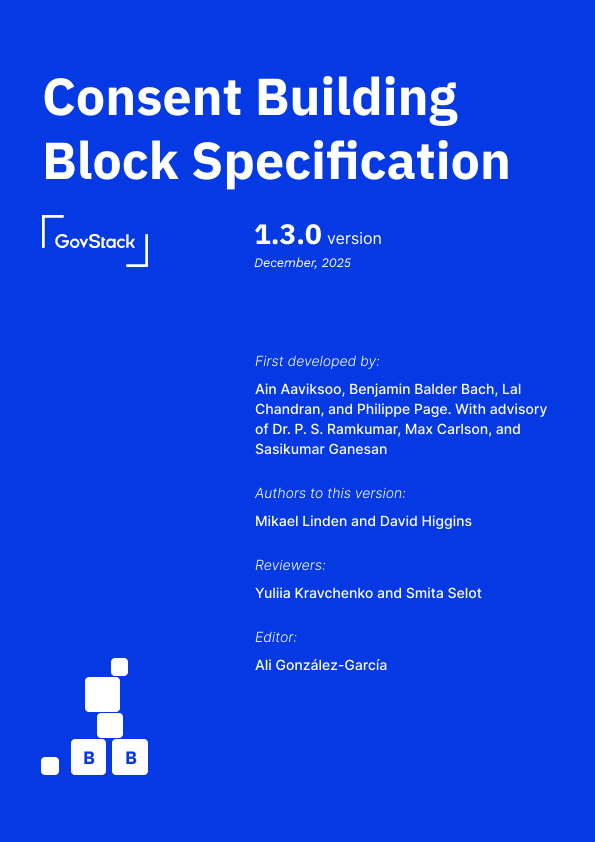

# Consent Building Block Specification

_**First developed by:**_ \
Ain Aaviksoo (Estonian Telecommunications Union), Benjamin Balder Bach (fmly Danish Tax & Revenue), Lal Chandran (MyData Global, iGrant.io), and Philippe Page (MyData Global, Human Colossus Foundation) \
&#xNAN;_**With advisors:**_ \
Dr. P. S. Ramkumar (ITU), Max Carlson (GovStack), and Sasikumar Ganesan (MOSIP)

***

_**Authors to this version:**_ \
Mikael Linden (Gofore), and David Higgins (Brook IT Consulting)

_**Contributors:**_ \
Charity Chirowamhangu, Antony Muriithi, Daniel Abadie, Norbert Nahayo, Rounak Nayak, Eric Ramirez, and Mary Metias

_**Reviewers:**_\
Yuliia Kravchenko (GovStack), and Smita Selot

_**Editor:**_\
Ali González-García

<figure><figcaption></figcaption></figure>
